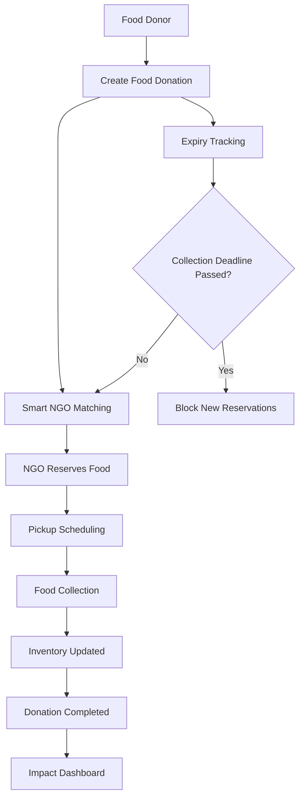
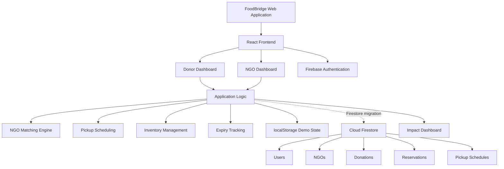

<div align="center">

# 🌱 FoodBridge
### Good Food Deserves a Better Destination

**An Intelligent Community Food Donation & Redistribution Platform**

Connecting surplus food donors with nearby NGOs through smart matching, pickup scheduling, expiry tracking, and inventory management.


**Hackathon Problem Statement: PS-43 | Community Food Donation Matcher**

</div>

---

## 📖 About FoodBridge

FoodBridge is a web-based food redistribution platform designed to reduce food waste by connecting surplus food donors with nearby NGOs and community organizations.

Every day, hostels, restaurants, canteens, hotels, and events generate surplus food. Meanwhile, NGOs and community kitchens need food donations.

However, a lack of communication and coordination often prevents this food from reaching those who need it.

**FoodBridge bridges this gap through intelligent matching and streamlined donation coordination.**

Our mission is simple:

> Save Food. Feed People. Reduce Waste.

---

## 🎯 Problem Statement

### PS-43 | Community Food Donation Matcher

**Context & Problem**

Surplus food and community needs may coexist because donors and recipient organizations cannot coordinate quickly.

**Expected Solution**

Match sample food donations with registered recipient organizations by quantity, location, and collection window, with expiry and collection-status tracking.

**Technical Focus**

- Matching
- Scheduling
- Inventory Status

FoodBridge addresses these requirements through a unified food donation management system.

---

## 💡 Our Solution

FoodBridge provides a digital platform where:

1. Food donors list surplus food.
2. The matching engine identifies suitable nearby NGOs.
3. NGOs reserve available food quantities.
4. Pickup appointments are scheduled.
5. Food collection progress is tracked.
6. Inventory updates automatically.
7. Impact analytics reflect completed collections.

### 🔄 Application Workflow



---

## ✨ Key Features

### 🍱 1. Food Donation Management

Donors can create food listings containing:

- Food name and category
- Quantity in meals
- Preparation timestamp
- Pickup location
- Permitted collection window
- Declared food expiry deadline
- Storage conditions
- Optional food image

Input validation helps prevent incomplete or invalid listings.

### 🤖 2. Intelligent NGO Matching

FoodBridge uses a deterministic weighted-scoring algorithm to recommend suitable recipient organizations.

The matching engine evaluates:

| Matching Factor | Weight |
|---|---|
| Geographic Distance | 40% |
| Collection Capacity | 30% |
| NGO Availability | 20% |
| Pickup Window Compatibility | 10% |

**Matching Score:**

```text
Match Score =
(Distance Score × 0.40)
+ (Capacity Score × 0.30)
+ (Availability Score × 0.20)
+ (Time Compatibility Score × 0.10)
```

NGOs must satisfy essential eligibility conditions before ranking.

The system uses the Haversine formula to calculate approximate geographical distances from latitude and longitude.

**Note:** This matching engine is rule-based, not a trained machine-learning model.

### 📅 3. Pickup Scheduling

Recipient organizations can schedule food collection within permitted time windows.

The system checks:

- Donor collection availability
- NGO pickup availability
- Declared food expiry deadline
- Existing reservation constraints

Invalid pickup appointments are rejected.

### ⏰ 4. Expiry Tracking

FoodBridge distinguishes between:

**Food Expiry Deadline:** The declared deadline for safe food handling.

**Collection Window:** The period during which NGOs are permitted to collect food.

Donation urgency states include:

- 🟢 Available
- 🟠 Expiring Soon
- 🔴 Expired

Expired batches are blocked from receiving new reservations.

FoodBridge does not independently certify food safety.

### 📦 5. Inventory Management

Each food donation maintains:

- Original quantity
- Available quantity
- Reserved quantity
- Collected quantity

**Inventory consistency rule:**

```text
Original Quantity =
Available Quantity + Reserved Quantity + Collected Quantity
```

Example:

```text
Original Donation: 100 Meals

NGO A Reserves: 60 Meals
NGO B Reserves: 40 Meals

Available: 0
Reserved: 100
Collected: 0
```

The system prevents reservations that exceed the available quantity.

### 🚚 6. Donation Status Tracking

FoodBridge supports the following donation lifecycle:

```text
Listed
   ↓
Matched
   ↓
Reserved
   ↓
Pickup Scheduled
   ↓
Collection In Progress
   ↓
Collected
   ↓
Completed
```

Additional states include expired and cancelled donations.

### 🗺️ 7. Interactive Location Map

FoodBridge integrates Leaflet and OpenStreetMap to visualize:

- Donor locations
- NGO locations
- Nearby food collection partners

The demonstration uses sample locations in Pune, Maharashtra.

### 📊 8. Impact Dashboard

The impact dashboard displays:

- Total meals collected
- Estimated food waste avoided
- Completed donations
- Active NGOs
- Donation trends
- Collection status analytics

Charts are generated using Recharts.

Food waste estimates use an assumed average meal weight and are clearly identified as estimates.

### 🔐 9. Firebase Authentication

Firebase Authentication integration has been implemented for:

- Email/password sign-in
- Account registration
- Donor accounts
- NGO accounts
- Google Sign-In support

The application also includes a demo role switcher for hackathon demonstrations.

### 🗄️ 10. Firebase Firestore Integration

The application includes Firebase SDK initialization and prepared database operations for:

- Users
- NGOs
- Donations
- Reservations
- Pickup schedules

Firestore transaction functions have been implemented for reservation and collection operations.

The existing demo workflow continues to use browser localStorage while full Firestore-backed data migration is completed.

---

## 🛠️ Technology Stack

| Layer | Technology |
|---|---|
| Frontend | React |
| Programming Language | TypeScript / JavaScript |
| Styling | Tailwind CSS |
| Icons | Lucide React |
| Maps | Leaflet + OpenStreetMap |
| Analytics | Recharts |
| Authentication | Firebase Authentication |
| Database | Cloud Firestore |
| Demo Persistence | Browser localStorage |
| AI Development | Google AI Studio |
| AI Model Integration | Google Gemini |
| Version Control | Git + GitHub |

---

## 🧠 Role of Artificial Intelligence

FoodBridge uses AI in two ways.

### 1. AI-Assisted Development

Google AI Studio was used as the primary development environment to generate and refine the application.

AI-assisted development supported:

- Frontend component generation
- UI/UX implementation
- Form validation
- NGO matching logic
- Pickup scheduling
- Inventory management
- Donation tracking
- Firebase integration

### 2. AI-Powered Features — Planned

Google Gemini integration is planned for:

**Food Image Categorization**

Identify possible food items and suggest categories from uploaded photographs.

**Automatic Food Description Generation**

Generate editable descriptions to simplify donation listing.

**Natural-Language Matching Explanations**

Explain the factors behind NGO recommendations.

**Donation Insights**

Summarize trends using actual donation records.

AI-generated food descriptions will require donor confirmation.

---

## 🏗️ System Architecture



---

## 📁 Project Structure

The repository contains the application source code generated and maintained through Google AI Studio.

Important components include:

```text
FoodBridge/
│
├── src/
│   ├── components/
│   │   └── FirebaseAuthModal.tsx
│   │
│   └── firebase.ts
│
├── firestore.rules
├── package.json
└── README.md
```

This is a simplified overview. Refer to the repository for the complete source structure.

---

## 🚀 Getting Started

### Prerequisites

Install:

- Node.js
- npm
- Git

### 1. Clone the Repository

```bash
git clone https://github.com/YOUR_USERNAME/FoodBridge.git
```

### 2. Open the Project

```bash
cd FoodBridge
```

### 3. Install Dependencies

```bash
npm install
```

### 4. Configure Firebase

Create or select a Firebase project and register a web application.

Enable the required Firebase services:

- Firebase Authentication
- Cloud Firestore

Configure the Firebase web SDK using the configuration approach provided in the repository.

Do not commit private service-account credentials or sensitive environment secrets.

### 5. Run the Application

```bash
npm run dev
```

Open the local development URL displayed in the terminal.

**Note:** Verify the available npm scripts in `package.json` before running the project.

---

## 🧪 Testing

According to the Google AI Studio development report, the application passed five unit tests.

### Unit Tests

| Test | Result |
|---|---|
| Haversine Distance Calculation | ✅ Passed |
| Expiry Urgency States | ✅ Passed |
| Weighted NGO Matching | ✅ Passed |
| Collection Window Validation | ✅ Passed |
| Partial Inventory Reservation | ✅ Passed |

**Reported Result: 5/5 Tests Passed**

### End-to-End Workflow Testing

The generated verification report also describes testing for:

- Donation creation
- Form validation
- NGO reservation
- Pickup scheduling
- Collection confirmation
- Inventory updates
- Impact dashboard updates

### Responsive Layout Testing

Reported screen sizes:

- Desktop: 1440 × 900
- Mobile: 390 × 844

These results reflect the generated development report and should be independently verified before production deployment.

---

## 🎬 Hackathon Demonstration

### Scenario: ABC College Hostel Has 100 Surplus Meals

**Step 1:** A donor creates a donation of 100 meals.

**Step 2:** FoodBridge recommends nearby eligible NGOs.

**Step 3:** NGO A reserves 60 meals.

**Step 4:** NGO B reserves the remaining 40 meals.

**Step 5:** Both NGOs schedule collection appointments.

**Step 6:** NGO A collects 60 meals.

**Step 7:** NGO B collects 40 meals.

**Step 8:** Inventory updates automatically.

**Step 9:** The donation is marked completed.

**Step 10:** The impact dashboard reflects the completed collection.

This workflow demonstrates the core PS-43 technical requirements:

**Matching • Scheduling • Inventory Status**

---

## 📈 Development Status

| Feature | Status |
|---|---|
| Public Website | ✅ Implemented |
| Donor Dashboard | ✅ Implemented |
| NGO Dashboard | ✅ Implemented |
| Food Donation Form | ✅ Implemented |
| Smart Matching Engine | ✅ Implemented |
| Pickup Scheduling | ✅ Implemented |
| Expiry Tracking | ✅ Implemented |
| Inventory Management | ✅ Implemented |
| Donation Tracking | ✅ Implemented |
| Impact Dashboard | ✅ Implemented |
| Interactive Map | ✅ Implemented |
| localStorage Persistence | ✅ Implemented |
| Firebase SDK Initialization | ✅ Implemented |
| Firebase Authentication UI | ✅ Implemented |
| Firestore Transaction Functions | ✅ Implemented |
| Full Firestore Data Migration | 🚧 In Progress |
| Gemini Food Recognition | 📅 Planned |
| Public Deployment | 📅 Planned |

---

## 🌍 Social & Environmental Impact

FoodBridge aims to reduce avoidable food waste while making donation coordination more efficient.

### Environmental Benefits

- Reduce unnecessary food disposal
- Encourage responsible food management
- Improve surplus food utilization
- Support sustainable consumption

### Social Benefits

- Connect food donors with NGOs
- Improve food collection coordination
- Reduce delays in redistribution
- Support community food assistance

### UN Sustainable Development Goals

FoodBridge aligns with:

- **SDG 2:** Zero Hunger
- **SDG 12:** Responsible Consumption and Production
- **SDG 13:** Climate Action

---

## 🔮 Future Enhancements

Planned improvements include:

- Gemini-powered food image categorization
- Automatic food description suggestions
- WhatsApp notifications
- Volunteer collection network
- Predictive surplus food forecasting
- Route optimization
- Multi-city expansion
- NGO verification workflows
- Advanced food safety checks
- Mobile application

---

## 🔒 Security & Food Safety

FoodBridge is currently a hackathon prototype.

For production deployment, additional controls are required, including:

- Verified NGO onboarding
- Strong role-based authorization
- Secure Firestore security rules
- Transaction-safe inventory updates
- Appropriate personal data protection
- Food handling and storage guidelines
- Compliance with applicable food safety regulations

FoodBridge facilitates donation coordination but does not independently certify that donated food is safe for consumption.

---

## 🤝 Contributing

Contributions, suggestions, and improvements are welcome.

1. Fork the repository.
2. Create a feature branch.
3. Make your changes.
4. Test the application.
5. Submit a pull request.

---

## 📄 License

License information will be added by the project maintainers.

---

<div align="center">

## 🌱 FoodBridge

### Save Food. Feed People. Reduce Waste.

**Good Food Deserves a Better Destination.**

Made with 💚 for a more sustainable future.

</div>
